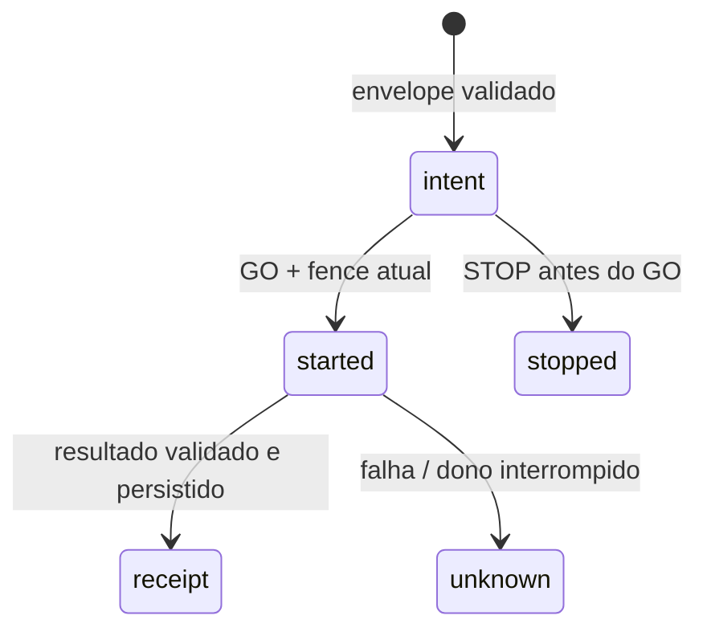

# Transporte fechado do executor de texto próprio

Implementação **parcial de BEES-010.1 (#23)**. `ExecutorTransport` define a fronteira
entre autoridade canônica e executor; `ProcessTextTransport` comprova o protocolo
com um processo POSIX próprio e a transformação `text.normalize@1`. Ele não é uma
VM nem sandbox do sistema operacional. Não oferece arquivos, shell, navegador,
código externo, rede, execução por LLM ou uso de computador pessoal.

O adaptador é opt-in por composição Python interna. Não é habilitado pelo catálogo,
por argumentos do modelo nem por endpoint novo. A ponte de diagnóstico health-only,
as credenciais `bh_` e o runtime de provisionamento `bp_` permanecem separados.

## Autoridade e recurso

`ProcessTextResource.initialize` é uma operação explícita do operador num diretório
privado próprio. Cria identidade e journal novos; não abre o banco do serviço.
A identidade vincula instalação, abelha e UUID do recurso. O campo de ambiente do
envelope identifica **esse recurso de processo**, não uma linha de VM pronta na
tabela `environments`. `adapter=local_process_text`, `identity=bees_user` e
`capabilities=[pure_text]` são constantes confiáveis. O processo roda com o UID
atual, sem elevação.

A instalação precisa existir no registro canônico `host_link_installation`.
A composição lê seu identificador, provisiona o recurso e usa o mesmo identificador
no `CoreToolAuthority`; o transporte não cria instalação ou pareamento implicitamente.
Uma identidade de VM/host não pode ser inferida a partir dessa prova de processo.

`CoreToolAuthority` reutiliza o preparo de intenção e as guardas reais do
`ToolService`, sem chamar o builtin do pai. Antes de abrir IPC, sela na ação o UUID
do pedido, alvo, hashes, prazo e fencing numa transação do core. Esses metadados
não incluem texto nem credencial de transporte. A ação já selada exige seu
transporte original: `ToolService.execute` recusa um novo despacho builtin com
`executor_transport_required`; consultar resultado terminal continua somente leitura.

O filho responde PREPARED após persistir a intenção. Imediatamente antes do GO,
a autoridade relê instalação, abelha, tarefa, execução, dono, todas as leases,
controle, contrato, revisões da extensão/concessão, política atual e parada global.
A geração da parada é capturada no preparo do transporte: stop seguido de resume
não neutraliza esse corte. Perguntar não equivale a aprovar; ask/deny não enviam GO.
Não existe callback permissivo ou autoridade padrão que substitua esses controles.

A autoridade confirma `dispatch_started` no core **antes** de enviar GO. Esse commit
é o corte de início: uma parada posterior não comprova cancelamento de efeito em
voo. Ao receber o receipt, o core revalida dono/fencing e autoridade. Perder lease,
controle, concessão, política ou geração da parada depois do efeito conserva a
situação como `outcome_unknown`, pausa a tarefa e não publica confirmação antiga.
O receipt privado do recurso permanece disponível para investigação; ele não
é uma autorização para reconciliar automaticamente nem repetir o efeito.

## Wire v1 e privacidade

O processo é iniciado com Python `-I -S -B`, diretório de trabalho privado, ambiente
herdado vazio, stdin/stdout/stderr em `DEVNULL` e somente um socket conectado
herdado. O Python pode criar `LC_CTYPE` para sua própria inicialização; nenhuma
variável do pai é copiada. O código filho importa exclusivamente módulos stdlib
e contratos/journal/runtime desse pacote. Não recebe caminho/conexão SQLite/APSW
do core, cofre, chave de modelo, endpoint de provedor ou credencial de provisionamento.

O socket é privado entre pai e filho; não existe listener ou porta HTTP. Cada sessão
recebe uma credencial efêmera `bx_` de 256 bits por esse canal, nunca por argv,
variável de ambiente, arquivo ou log. O filho recusa `bp_`, `bh_` e segredos bx_
incorretos. A posse do canal e o bootstrap confiável do operador são a autoridade
da sessão; isso não implementa pareamento remoto ou autenticação entre máquinas.

Cada frame tem comprimento de 32 bits big-endian seguido de objeto JSON UTF-8 de
até 32 KiB. Chaves extras/duplicadas, JSON incompleto, NaN/Infinity, versões e tipos
incompatíveis são recusados. UUIDs são canônicos e não nulos. O envelope fechado inclui:

| Campo | Origem/limite |
| --- | --- |
| protocol / tool_name / tool_version | `1`, `text.normalize`, `1`. |
| installation_id / agent_id / resource_id / environment_id / adapter / identity | Identidade privada provisionada e composição confiável. |
| action_id / request_id / run_id | Ação canônica e pedido selado antes do IPC. |
| owner_id / generation / control_revision / safety_generation / binding_hash | Claim atual, vínculo completo e parada capturados no core. |
| input_hash | SHA-256 do contrato completo de argumentos. |
| deadline_ms | Prazo UTC, limitado a cinco segundos e ao vencimento das leases. |

Há um prazo monotônico único de cinco segundos para cada sessão, incluindo framing;
um fragmento não renova o prazo. O pai encerra apenas seu filho em falha/timeout.
A entrada aceita até 4.096 caracteres/8 KiB e operações trim/upper/lower; a saída
aceita até 8.192 caracteres/16 KiB. NUL e Unicode inválido são recusados. Não há
limite de memória/CPU imposto pelo SO; os limites do protocolo e do algoritmo
fixo não tornam código arbitrário seguro.

GO/STOP carregam hash exato e nonce da preparação. Um GO velho, de outro pedido,
ou com credencial errada não inicia a operação. Resultado possui contrato fechado,
correlação exata e validação de tamanho; saída inválida após início vira unknown.
Erros só contêm códigos fechados. Texto entra pelo canal privado e o resultado
fica no receipt e registro privado de ação; eventos/atividade pública não incluem
esses textos. Não forneça credenciais nos argumentos de ferramenta.

## Journal local formato 1

O recurso possui `identity.json`, `resource.lock` e `journal.sqlite3` privados,
independentes do SQLite/APSW canônico. A implementação inicial exige POSIX,
UID dono, diretório 0700, arquivos 0600, sem symlinks/hardlinks. Windows falha
fechado enquanto ACL/handles e locks equivalentes não forem comprovados.

SQLite stdlib usa DELETE/FULL e transações curtas; o lock exclusivo é mantido
por toda a vida do processo dono. Um segundo processo não recebe acesso enquanto
o dono estiver vivo. Inicialização parcial, identidade divergente ou formato
incompatível falham sem recriar/corrigir/apagar arquivos. A abertura não migra formatos.



A identidade/hash do pedido é imutável; cada ação e request_id são únicos no
journal. Mesmo ID com parâmetros, prazo, dono ou alvo diferentes gera conflito.
Events são append-only; receipt/unknown/stopped são finais. Há até 10.000 ações por
journal e nenhum descarte automático para liberar IDs.

Receipt é confirmado **antes** da resposta IPC. Replay conhecido só consulta o
estado, inclusive intent/stopped/unknown; não chama a transformação novamente.
Abrir o journal depois da morte do dono converte started em unknown sob o lock
exclusivo. Um receipt persistido e cuja resposta se perdeu continua receipt local,
mas o core conserva unknown. `inspect` é consulta privada explícita; não envia GO,
não muda de máquina e não publica/reconcilia o resultado no core.

## Composição interna de referência

O chamador confiável fornece uma ação preparada por `ToolService.prepare` com
claim real da fila; a instalação/recurso são escolhas explícitas do operador:

```python
from bees_core.executor_transport.authority import CoreToolAuthority
from bees_core.executor_transport.client import ProcessTextResource, ProcessTextTransport

# Inicialização explícita, uma vez, em diretório privado próprio.
resource = ProcessTextResource.initialize(resource_dir, installation_id, str(agent.id))
# Em reinícios, apenas abrir o recurso já provisionado:
resource = ProcessTextResource.open(resource_dir)

authority = CoreToolAuthority(
    tools,
    resource.identity,
    agent.id,
    prepared_action.id,
    arguments,
    expected_revision=prepared_action.revision,
    claim=claim,
)
resulting_action = ProcessTextTransport(resource).execute(authority)
```

Essas variáveis vêm da composição confiável, não do texto do modelo. Não passar
o caminho do core/cofre como `resource_dir`. O processo usa o mesmo UID do serviço:
a separação de IPC e de dados fornecidos **não bloqueia acesso ao filesystem pelo
SO**. Por isso o adaptador só executa o código fixo revisado de texto; nenhuma
extensão carregada, executável configurável ou fallback para outra máquina é aceito.

## Evidência e portões restantes

Testes usam core/ToolService/claims/leases/concessões/políticas reais, subprocessos
próprios, socket IPC, arquivos privados e SQLite local. Cobrem validação negativa,
GO recusado após revogação, stop/resume, concorrência, crash após efeito/receipt,
saída inválida, processo sem segredos herdados, replay sem efeito duplicado e
publicação recusada ao perder autoridade. Fault injection do harness modifica
somente o filho de teste e não é uma opção do produto.

Esse recorte desbloqueia o contrato para o ciclo limitado de ferramentas (#24)
e composição de skills (#67), que continuam tarefas próprias. Não comprova
identidade/isolamento de VM, canal remoto autenticado, aprovação de ferramentas
externas, sandbox, quotas do SO, navegador/arquivos/shell, nem uma ferramenta
selecionada por modelo real. Esses portões continuam abertos em #23 e dependências.
